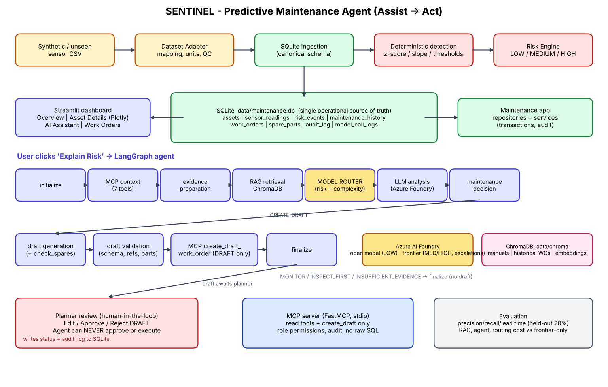
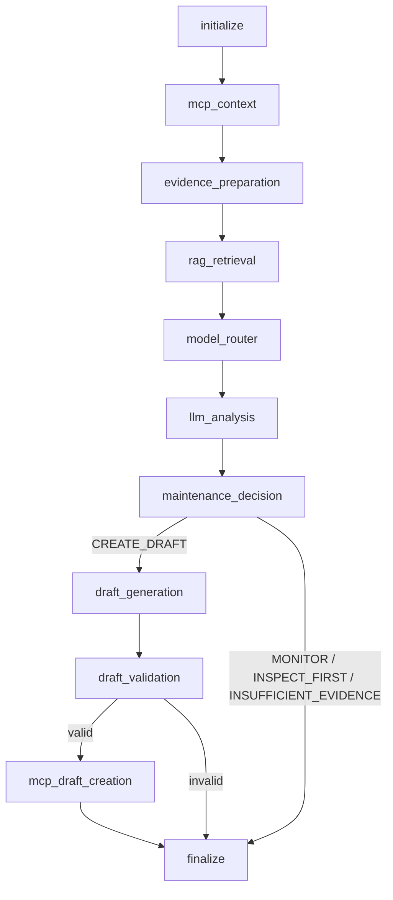

# Predictive Maintenance Agent (Azure AI Foundry · LangGraph · MCP · ChromaDB · Streamlit)



## 1–2. Overview & use case
Plant equipment (pumps, motors, compressors) fails unexpectedly; early signs sit in sensor data and maintenance history, but planners lack time to analyse them. SENTINEL (1) ingests sensor data, (2) detects anomalies **deterministically**, (3) scores **transparent LOW/MEDIUM/HIGH risk**, (4) lets a user click **Explain Risk**, which runs a **LangGraph** agent that reads operational data through **MCP**, retrieves manuals/history from **ChromaDB**, routes to an **open or frontier Azure AI Foundry model**, explains likely failure modes **with citations**, **decides** whether a work order is justified and — only then — creates a **DRAFT** through MCP. A human planner approves / edits / rejects. Everything is audited.

The system keeps five things distinct: *detected anomaly* · *predicted risk* · *suspected failure mode* · *confirmed fault* (from a maintenance inspection record) · *recommended action*.

## 3–4. Architecture & workflow
See diagram above and `ARCHITECTURE.md`. Flow: CSV → Dataset Adapter → SQLite → detection → risk engine → `risk_events` → dashboard → *Explain Risk* → LangGraph (MCP context → evidence → RAG → **router** → analysis → **decision** → [draft → validate → MCP create DRAFT]) → planner review → SQLite + `audit_log`.

## 5. Databases (exactly two)
* **SQLite** `data/maintenance.db` — operational truth (assets, sensor_readings, risk_events, maintenance_history, spare_parts, work_orders, work_order_parts, audit_log, model_call_logs; `schema_migrations` for versioning). Dashboard, MCP server and scripts all use this one file.
* **ChromaDB** `data/chroma/` — manuals, historical work orders, with metadata `document_id, document_type, document_title, asset_type, failure_mode, section, page_number, source_file, citation_ref`.

## 6. Dataset
`scripts/generate_dataset.py` (seed `20261109`): 20 assets (8 pumps, 7 motors, 5 compressors), 30 days hourly, vibration/temperature/pressure/current, noise + diurnal cycle, 9 healthy + 11 degrading assets (vibration rise, overheating, pressure drift, current abnormality, multi-sensor), point-level labels, `degradation_events.csv`, maintenance history (incl. one **confirmed fault**), 12 spare parts, 10 manuals, 9 historical work orders. Wide CSV has 14,400 rows (57,600 canonical readings). **Held-out split**: 4 assets (20%) in `split.json`, never used for tuning.

## 7. Detection (deterministic, `src/detection`)
Per sensor: resample (1 h) → baseline = first 168 h of that asset → rolling mean/std (12 h) → z-score & % deviation → trend slope (48 h) → absolute warning/critical thresholds per asset type (`config/detection_config.yaml`) → a point is abnormal if `|z|≥3 & dev≥8%` **or** a threshold is breached → ≥6 consecutive hours = **sustained** window; single large excursions = **isolated anomaly**. Evidence per sensor: baseline, current mean, z, slope, deviation %, thresholds, rule, window, severity. Missing data is never zero-filled.

## 8. Risk scoring (`config/risk_config.yaml`)
`score = 100 × (0.30·severity + 0.15·trend + 0.20·threshold_breach + 0.15·multi_sensor + 0.10·persistence + 0.10·service_age) × criticality_factor`; LOW <35, MEDIUM <70, HIGH ≥70. Isolated anomalies are capped at 30; a confirmed fault floors the score at 80 and sets type `CONFIRMED_FAULT`. Output: level, score, reason, evidence, affected sensors, trend summary, signal confidence, classification, monitoring urgency, full component breakdown. No LLM involved.

## 9. RAG (`src/rag`)
Section-aware chunks → Azure embedding deployment → ChromaDB (cosine). Retrieval filters on `asset_type` (+`general`) and candidate failure modes derived from affected sensors (a *filter*, not a diagnosis), applies `min_similarity`, returns `RetrievedEvidence` with `[DOC:<id>#<section>]` citations. **No unfiltered fallback**: if nothing relevant exists the agent must say evidence is insufficient (Demo 5: compressor current has no manual). Citations in LLM output are verified against retrieved chunks; unknown ones are stripped and reported.

## 10. MCP (`src/mcp_server`)
Official Python SDK (FastMCP). Tools: `get_asset, get_sensor_history, get_risk_events, get_maintenance_history, get_asset_work_orders, check_spares, create_draft_work_order`. Fixed operations only (no SQL), role permissions (`agent`: read + create DRAFT; `readonly`), validation, audit record per call. Two clients share one tool registry: `InProcessMCPClient` (default) and `StdioMCPClient` (real MCP over stdio; set `mcp.transport: stdio` in `config/app_config.yaml`).

## 11. LangGraph (`src/agent`)
Nodes: initialize → mcp_context → evidence_preparation → rag_retrieval → model_router → llm_analysis → maintenance_decision → (draft_generation → draft_validation → mcp_draft_creation) → finalize, with conditional edges (`routing.py`) and `MemorySaver` checkpointing. Guardrails (deterministic, documented): a **confirmed fault is never dismissed** (decision upgraded to CREATE_DRAFT); **no CREATE_DRAFT without retrieved evidence** unless a fault is confirmed; **no duplicate draft** if an open work order exists; invalid drafts (bad parts/priority/references/schema) **never reach SQLite**; healthy assets get MONITOR without an LLM call.


## 12. Model routing (`src/agent/model_router.py`, `config/model_routing.yaml`)
After retrieval, before analysis: LOW→**open**, MEDIUM/HIGH→**frontier**. LOW escalates to frontier on: ≥2 abnormal sensors, ≥3 plausible failure modes, low-confidence signal, conflicting sensor directions, or a complex request ("recommend", "work order", …). The router never changes risk. If the open model call fails, the call falls back to the frontier deployment (logged). Every call is logged to `model_call_logs` (tokens as reported by Azure — `NULL` if unavailable, never invented; cost from configurable pricing). *Analytics* page and `evaluate_agent.py` compare against a frontier-for-everything baseline.

## 13–14. Azure AI Foundry setup & environment
1. Deploy in one Foundry/Azure OpenAI resource: an **open model**, a **frontier model**, and an **embedding model**.
2. `copy .env.example .env` and fill endpoint, key, API version and the three **deployment names** (optional separate endpoint/key for the open model).
3. Verify: `python scripts/check_azure.py`. Edit `pricing_usd_per_1m_tokens` in `config/model_routing.yaml` to your real prices.
The client uses the `openai` SDK's `AzureOpenAI` against your deployments (JSON mode; auto-drops unsupported params such as `temperature`/`response_format`). If your open model is served via a different API surface, replace `FoundryLLM` (one class implementing `chat_json`).

## 15–21. Installation & execution (Windows PowerShell; Python 3.10+)
```powershell
python -m venv .venv ; .\.venv\Scripts\Activate.ps1
pip install -r requirements.txt
copy .env.example .env            # then edit
python scripts/bootstrap_all.py   # generate → validate → init DB → ingest → detect → index ChromaDB → held-out eval
# or step by step:
python scripts/generate_dataset.py ; python scripts/validate_dataset.py ; python scripts/initialize_database.py
python scripts/ingest_dataset.py ; python scripts/run_detection.py ; python scripts/ingest_documents.py --reset
python -m src.mcp_server.server   # optional: standalone MCP server (stdio)
streamlit run app.py
```
`python scripts/bootstrap_all.py --skip-docs` runs everything except ChromaDB indexing (the dashboard works; AI analysis needs indexed docs + Azure).
**Unseen data:** `python scripts/ingest_dataset.py --readings my.csv --assets my_assets.csv [--mapping map.yaml] [--dayfirst]` or upload in the app sidebar, then *Run detection now*. Handles other column names, units (°F, psi, kPa, mA, in/s…), timestamp formats/epochs, sampling rates, missing/duplicate/invalid rows, extra sensors, unknown assets (`--unknown-assets register|reject`), long or wide format, and prints a data-quality report.

**Cleaning up uploads / restoring the demo set** (always backs up to `data/backups/` first):
```powershell
python scripts/reset_database.py --list                # show asset count and which are not part of the original 20
python scripts/reset_database.py --remove-uploaded     # delete only assets that are not in the generated dataset
python scripts/reset_database.py --remove NEW-1 NEW-2  # delete specific assets
python scripts/reset_database.py --restore-synthetic   # rebuild DB from the original synthetic data
```
The sidebar also has **Manage assets (delete)**. After a CSV upload the app now runs detection automatically; an asset with too little history (needs ≥48 readings in its first 168 h) is shown as **Not assessed**, not LOW.

## 22. Work-order review
*Work Orders* page: view, edit fields/steps/parts, approve, reject (reason required). Enforced in the service layer (`planner` role; names starting `AGENT` are refused), transactional, with before/after JSON in `audit_log`. Only DRAFT can change; APPROVED/REJECTED are final here. Nothing is executed.

## 23. Evaluation
```powershell
python scripts/evaluate_detection.py --split heldout     # final numbers (dev: --split dev)
python scripts/evaluate_rag.py                           # retrieval relevance / insufficient-evidence handling
python scripts/evaluate_agent.py --split heldout         # LIVE Azure: decisions, drafts, citations, governance, routing cost (scratch DB copy)
python scripts/generate_report.py                        # reports/evaluation_report.md
```
Detection result in this sandbox (synthetic data): held-out point-level precision 0.957 / recall 0.910 / F1 0.933 / FPR 0.6 %, event recall 3/3, 0 healthy false alarms, mean lead time ≈534 h before projected failure; dev F1 0.937 (no sign of over-fitting). These numbers describe the synthetic generator, **not** real plants.

## Ideal workflow (what the app now does by itself)
1. **Data in** → detection runs (also automatically after a CSV upload) → risk events in SQLite.
2. **Knowledge base**: on the first AI analysis the app *auto-indexes* the 10 manuals + 9 historical work orders into ChromaDB if it is empty or was built with a different embedding model (also: **AI Assistant → Knowledge base → Index / re-index**).
3. **Explain Risk** → MCP context → RAG (filters by asset type + candidate failure modes) → router → analysis with citations and confidence → decision.
4. If justified (or a fault is confirmed) → draft generated → **auto-corrected for harmless slips** (fabricated parts/references removed, priority raised to match risk; every change is shown as a warning) → validated → saved via MCP as DRAFT.
5. **Work Orders** page lists drafts (sidebar shows *Drafts awaiting review*) → planner edits / approves / rejects → audit log.
When retrieval returns nothing, the AI Assistant shows *why* (empty index, no documents for that asset type/failure mode, or all below `min_similarity`) under **Retrieval diagnostics**. Assets whose type has no manual (e.g. type `unknown` from an upload, or compressor current anomalies) intentionally end as `INSUFFICIENT_EVIDENCE` with no draft. Use **Batch** to analyse all HIGH-risk assets at once.

## 24. Troubleshooting
* *Azure not configured* → AI analysis shows a clear error; run `check_azure.py`. * *Chroma empty / no citations* → run `ingest_documents.py --reset`; the app auto-indexes on first analysis; if it still shows 0 sources open *Retrieval diagnostics*. `rag.min_similarity` defaults to 0.15. * *Tokens "unavailable"* → provider did not return usage; cost stays NULL by design. * *Windows + chromadb build errors* → use Python 3.11/3.12 wheels. * *No risk event* → run `run_detection.py`.

## 25. Limitations
* Built and unit-tested in an offline sandbox: **streamlit, plotly, chromadb, langgraph, mcp, pydantic and Azure were not installable there.** Core logic was verified with a pydantic stand-in, a fake LLM and an in-memory vector store (test doubles live only in `tests/`); Streamlit pages were smoke-run against a fake `streamlit`/`plotly`. The real-library paths (Chroma persistence, LangGraph compile/checkpoint, FastMCP server, stdio client, Plotly rendering, Azure calls, Pydantic v2 validation) are implemented per the SDK docs but **not executed** — run `pytest` and the demo on your machine first.
* Detection assumes the first 7 days of each asset are healthy; thresholds are per asset type in YAML; the data is synthetic so metrics are optimistic.
* Cost/price values are placeholders; routing evaluation needs real logs.
* Stdio MCP client spawns a server per call (slower; in-process is the default).

## 26. Demo workflow
1. **Healthy** — Overview → `PMP-101` (LOW) → trends flat → *Explain Risk*: open model, MONITOR, no draft.
2. **Degrading** — `PMP-102` (MEDIUM, vibration): flagged window, evidence table → *Explain Risk*: frontier, manual citations, INSPECT_FIRST.
3. **Multi-sensor high** — `MTR-207` (vibration+temperature+current) or `CMP-305`: HIGH → frontier → draft created via MCP. `PMP-106` has a **confirmed fault** (never dismissed).
4. **Draft review** — Work Orders → edit/approve one, reject another with reason → audit trail.
5. **Insufficient evidence** — `CMP-303` (compressor current anomaly, no manual): explanation states evidence is unavailable, `INSUFFICIENT_EVIDENCE`, no draft.

## Project structure
`app.py` · `config/` · `data/{synthetic,manuals,historical_work_orders}` · `scripts/` · `src/{common,ingestion,detection,maintenance_app,mcp_server,rag,agent,review,evaluation,dashboard}` · `tests/` · `docs/` · `reports/`.
Changes vs the proposed tree: repositories/migrations are single modules (`repositories.py`, `migrations/__init__.py`); added `src/dashboard/data.py`, `src/mcp_server/client.py`, `src/agent/llm_client.py`, `scripts/{bootstrap_all,check_azure}.py`.


#HOW TO RUN THE PROJECT
create a virtual environment : py -3.11 -m venv venv  
activate virtual environment :  .\venv\Scripts\Activate.ps1 
install all package requirements:  pip install -r requirements.txt  
create a .env file with this structure : 
AZURE_AI_FOUNDRY_ENDPOINT=
AZURE_AI_FOUNDRY_API_KEY=
AZURE_AI_FOUNDRY_API_VERSION=2025-04-01-preview
AZURE_OPEN_MODEL_DEPLOYMENT=gpt-4.1-mini
AZURE_FRONTIER_MODEL_DEPLOYMENT=gpt-4o  
AZURE_EMBEDDING_DEPLOYMENT=text-embedding-3-small   

run this command to check if azure connection is done : python scripts/check_azure.py 
run this command to load the readings and run detection and ingest the documents: python scripts/bootstrap_all.py     
run the frontend dashboard: streamlit run app.py 


